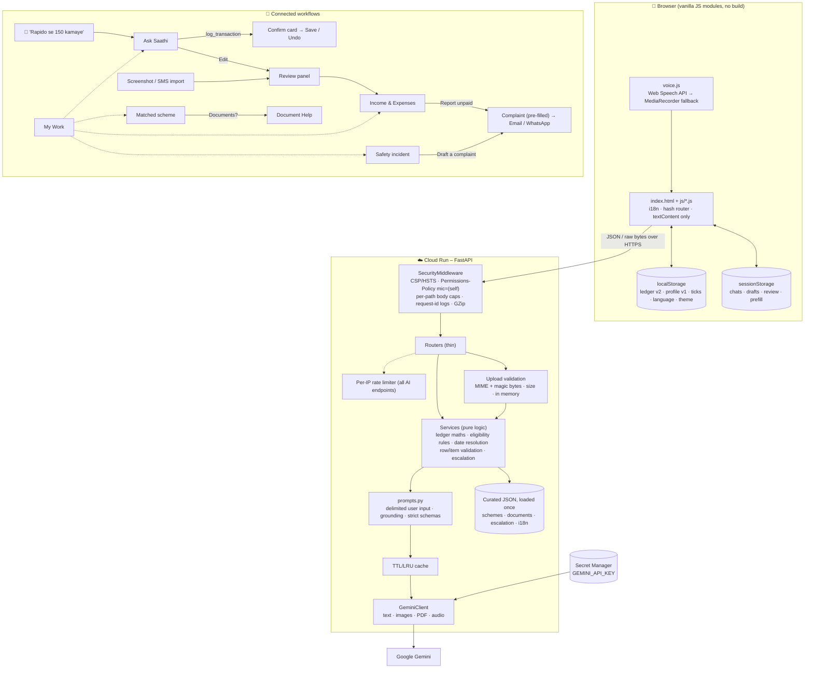

# Saathi – a GenAI companion for gig & informal workers

**Saathi** ("companion") is a mobile-first web app that helps delivery partners, cab and bike-taxi drivers, home-service partners and daily-wage workers in India **track income and expenses, stay safe, discover welfare schemes, get documents ready and send complaints**, in simple words in **English, Hindi, Punjabi, Tamil, Bengali and Marathi**. Workers can type or **speak**.

NITI Aayog estimated 77 lakh gig workers in India in 2020–21, projected to reach 2.35 crore by 2029–30. Most never learn which schemes they qualify for, which papers they need, or how to write a formal complaint when a payout goes missing. Many juggle several apps and kinds of work. Saathi combines **deterministic, verifiable logic** (money maths, rule-based eligibility, curated helplines and confirmed escalation contacts) with **Google Gemini**, which reads screenshots, understands speech and Hinglish, explains, advises and drafts in the worker's own language.

> **Live app:** `https://<YOUR-CLOUD-RUN-URL>` &nbsp;·&nbsp; **Demo video:** `https://<YOUR-DEMO-VIDEO-LINK>`
>
> **No login is required.** Every feature is open to evaluators. The worker's data stays in their own browser.

---

## 1. Features mapped to the problem statement

| Problem statement asks for… | Saathi feature | How it works |
|---|---|---|
| **Earnings tracking** | 💰 **Income & Expenses** | A ledger of individual income and expense entries, so a standalone "₹200 on petrol" is just one expense. Each entry has amount, category, optional platform, work type, hours and note. Stored in versioned `localStorage` (v1 data migrates automatically). `POST /api/ledger/summary` computes income, expenses, net, ₹/hour, today, weekly/monthly totals, per-platform and per-work-type breakdowns and best platform/day **in plain Python**. "Get AI advice" sends only the PII-free summary to Gemini. CSV export. |
| | 📥 **Import from screenshot / PDF / SMS** | Upload a UPI or platform-earnings screenshot (PNG/JPG/WEBP) or a PDF statement (≤ 5 MB), or paste bank/UPI SMS text (≤ 5000 chars). Gemini returns structured rows; **each row is validated on its own** and bad rows are dropped with a visible note. The worker reviews, edits or unticks every row before anything is saved. Files stay in memory and are never stored. |
| | 🗣️ **Log by speaking or typing** | In Ask Saathi, "aaj Swiggy se 800 kamaye aur 200 ka petrol dala" becomes two proposed entries. Dates like *aaj/kal* are resolved **in code** from the worker's local date. A confirmation card saves everything with one tap of **Save** (never automatically), shows today's total and offers **Undo** for 10 seconds. |
| **Multiple kinds of work** | 🧰 **My Work profile** | Multi-select work types (delivery, ride-hailing, bike taxi, home services, daily wage, domestic work, other) and platforms (Swiggy, Zomato, Uber, Ola, Rapido, Urban Company, Bharat Taxi, Porter, Blinkit, Zepto, other/contractor). Offered on first visit and skippable. Used across the app: your platforms list first, summaries break down by work type, scheme eligibility uses your work types, and safety chat / Ask Saathi get them as context (no PII). |
| **Safety practices** | 🦺 **Safety Assistant** | Gemini chat on road safety, night shifts, heat, harassment, accidents and breakdowns, tailored to your kinds of work. A fixed emergency bar (112, 108, 1091, 181) is always visible as `tel:` links. These are hardcoded, and phone numbers are stripped from AI text. |
| **Rights & welfare scheme awareness** | 🏛️ **Schemes & Rights** | Questionnaire (age, income, work types, state, bank account) → **rule engine** over `app/data/schemes.json` (e-Shram, PM-SYM, PMJJBY, PMSBY, AB PM-JAY, Code on Social Security 2020) → Gemini explains **only the matched records**, each with its official link and "Check the official site before applying". |
| **Document help** | 📄 **Document Help** | Six goals plus any scheme's own checklist, from `documents.json`. Ticks are saved locally. Gemini gives step-by-step help grounded on the checklist, plus follow-up Q&A. |
| **Grievance / dispute drafting** | ✉️ **Complaint letter** | Gemini drafts a formal letter in English **and** the user's language, plus next steps. Then: **Send by email** (`mailto:` the platform's grievance address, only where confirmed on the platform's own site), **Share on WhatsApp** (`wa.me`), **Open official help page**, **Copy** and **Download**. "Where to send it" comes from `escalation.json` (platform, labour department, SAMADHAN, National Consumer Helpline 1915, NCW, police), never from the LLM. |
| **Multilingual, simple language** | 🌐 6 languages + 🎤 voice | Every UI string is in `app/data/i18n/*.json`. Every prompt requires the selected language at a primary-school reading level. A mic button sits beside every free-text field. |

### Connected workflows

- **Income & Expenses → Complaint:** any income entry → "Report unpaid / wrong payment" opens the complaint form pre-filled with platform, date and amount.
- **Schemes → Documents:** "What documents do I need?" opens that scheme's checklist.
- **Safety → Complaint:** an incident reply offers "Draft a complaint" with the issue pre-selected.
- **Ask Saathi (typed or spoken):** Gemini classifies intent into a **fixed enum** (structured JSON). Money mentions go to the confirmation card; other intents route with context pre-filled; general questions are answered inline.
- **Import / Ask "Edit" → review:** both open the same editable review panel; nothing is saved without the worker's tap.
- The language, theme and profile persist. Routes use the URL hash and drafts live in `sessionStorage`, so a refresh never loses your place.

---

## 2. GenAI services used & where

All calls go through `app/llm/client.py::GeminiClient` (official **`google-genai`** SDK, async, overall deadline, one retry on transient errors, honest errors and never canned text). The model comes from `GEMINI_MODEL` (default **`gemini-3.6-flash`**; Google has closed `gemini-2.5-flash` to new keys). Thinking is off (`thinking_budget=0`) for speed on low-end phones.

| Feature | Endpoint | File / function | Input → output | What Gemini generates |
|---|---|---|---|---|
| Income advice | `POST /api/ledger/advice` | `services/ledger.py::generate_advice` | summary → JSON `{tips[]}` | 3 tips from the computed summary |
| **Import screenshot / PDF** | `POST /api/ledger/import/file` | `services/imports.py::import_from_file` | **image/PDF bytes (multimodal)** → JSON rows | `{date, amount, direction, counterparty, suggested_platform, suggested_category, confidence}` per transaction |
| **Import SMS text** | `POST /api/ledger/import/text` | `services/imports.py::import_from_text` | text (long numbers masked) → JSON rows | same rows as above |
| Ask Saathi + **`log_transaction`** | `POST /api/ask` | `services/router_intent.py::route_question` | text → JSON `{intent (enum), answer, prefill, transactions[]}` | intent, routing context, and for money: `{type, amount, platform, category, day, confidence}` per item (dates resolved in code) |
| **Voice transcription (fallback)** | `POST /api/voice/transcribe` | `services/voice.py::transcribe` | **audio bytes (multimodal)** → JSON `{transcript, has_speech}` | transcript in the selected language |
| Safety chat | `POST /api/safety/chat` | `services/safety.py::safety_reply` | text + work types → JSON | safety steps + whether to offer a complaint |
| Scheme explanation | `POST /api/schemes/explain` | `services/schemes.py::explain_schemes` | matched records → text (cached) | plain-language explanation |
| Document steps | `POST /api/documents/explain` | `services/documents.py::explain_checklist` | checklist → text (cached) | step-by-step guide |
| Document Q&A | `POST /api/documents/ask` | `services/documents.py::answer_question` | checklist + question → text | answer |
| Complaint draft | `POST /api/grievance/draft` | `services/grievance.py::draft_grievance` | facts + description → JSON | letters in English + user's language, next steps |

**Voice:** the browser's **Web Speech API** is used first (`en-IN`, `hi-IN`, `pa-IN`, `ta-IN`, `bn-IN`, `mr-IN`, with live interim text). Gemini is only the **fallback**: when the browser has no speech engine, or its speech service fails, the app records up to 60 s with `MediaRecorder` and calls `/api/voice/transcribe`. If neither method is possible, or there is no microphone, the mic button is not shown. Transcripts are inserted for review; forms are never auto-submitted.

All prompt templates and the shared system prompt are in **`app/llm/prompts.py`**.

---

## 3. Architecture



```
app/
  main.py            app factory, middleware (per-path body caps), routers, static, /health
  config.py          pydantic-settings; ENV=production|development|test; fail-fast on missing key
  security.py        headers/logging/body-cap middleware, rate limiter, sanitising helpers
  errors.py          AppError + central handlers → {"error": {"code", "message"}}
  cache.py           TTL + LRU cache for deterministic AI calls
  llm/client.py      LLMClient Protocol, GeminiClient (text + inline image/PDF/audio), honest errors
  llm/prompts.py     every prompt template + system prompt
  models/            Pydantic v2 schemas: ledger, imports, ask, voice, schemes, documents, grievance, safety
  services/          ledger, imports, uploads, voice, router_intent, schemes, documents, grievance, safety
  routers/           one thin router per feature
  data/              schemes.json, documents.json, escalation.json (sourced + dated), i18n/*.json
static/
  index.html, styles.css (theme tokens), fonts/ (self-hosted Noto, OFL)
  js/ theme, core, voice, ledger, profile, ask, safety, schemes, documents, grievance, main  (~79 KB total)
tests/               unit + API tests; tests/fakes.py holds FakeLLMClient (test-only)
```

---

## 4. Setup, run & test

Requires Python 3.11+.

```bash
python -m venv .venv
source .venv/bin/activate          # Windows: .venv\Scripts\activate
pip install -r requirements-dev.txt
cp .env.example .env               # then put your GEMINI_API_KEY in .env
```

| Task | Command |
|---|---|
| Run locally (auto-reload) | `make run` → http://localhost:8080 |
| **Everything** (lint + types + tests with coverage ≥ 85%) | `make test` |
| Lint / format | `make lint` / `make format` |
| Type-check (mypy `--strict`) | `make typecheck` |
| Dependency audit | `make audit` |

No `make`? Run `python -m uvicorn app.main:create_app --factory --reload --port 8080` and `python -m pytest --cov`.

Tests never touch the network or a real key. They inject `tests/fakes.py::FakeLLMClient` through `create_app(llm_client=...)`, and the app refuses any non-Gemini client when `ENV=production`.

---

## 5. Deploy to Google Cloud Run

```bash
PROJECT_ID=your-project
REGION=asia-south1
gcloud config set project $PROJECT_ID
gcloud services enable run.googleapis.com secretmanager.googleapis.com cloudbuild.googleapis.com artifactregistry.googleapis.com

# 1) Store the Gemini key in Secret Manager (never in the image or the repo)
printf "%s" "YOUR_GEMINI_API_KEY" | gcloud secrets create gemini-api-key --data-file=-

# 2) Let the Cloud Run runtime service account read it
PROJECT_NUMBER=$(gcloud projects describe $PROJECT_ID --format='value(projectNumber)')
gcloud secrets add-iam-policy-binding gemini-api-key \
  --member="serviceAccount:${PROJECT_NUMBER}-compute@developer.gserviceaccount.com" \
  --role="roles/secretmanager.secretAccessor"

# 3) Build from the Dockerfile and deploy
gcloud run deploy saathi \
  --source . \
  --region $REGION \
  --allow-unauthenticated \
  --set-env-vars ENV=production,GEMINI_MODEL=gemini-3.6-flash \
  --set-secrets GEMINI_API_KEY=gemini-api-key:latest \
  --memory 512Mi --cpu 1 --concurrency 40 --max-instances 5
```

The container runs as a non-root user on `python:3.11-slim` and listens on `$PORT`. With `ENV=production` it **refuses to start** if `GEMINI_API_KEY` is missing. Voice input needs HTTPS, which Cloud Run provides.

---

## 6. Security, efficiency, accessibility & responsible AI

### Security
- **Secrets** come only from env / Secret Manager (`SecretStr`, never logged). `.env*` is git- and docker-ignored.
- **Strict Pydantic validation** (`extra="forbid"`): text length limits, amount ranges (> 0, ≤ ₹10 lakh per entry), enums for platform, work type, category, issue type, language and state, dates not in the future (India time), category consistent with income/expense.
- **Uploads** are sent as raw request bodies (not multipart) so files never touch disk. Each upload's declared type must be on an allow-list **and match its magic bytes** (PNG/JPEG/WEBP/PDF; WebM/Ogg/WAV/MP4/MP3/AAC/FLAC). Per-path body caps are 5 MB for imports and 2 MB for audio; everything else stays at 1 MB. Empty → 422, wrong type → 415, too big → 413.
- **Rate limiting** per IP on every Gemini endpoint (including import and transcription), returning a friendly, translated 429.
- **Headers:** CSP `default-src 'self'` (no inline scripts or styles; fonts self-hosted), HSTS, `X-Content-Type-Options`, `X-Frame-Options: DENY`, `Referrer-Policy`, and `Permissions-Policy: microphone=(self)` with camera, geolocation, payment, USB and display capture denied. `MediaRecorder` needs no CSP changes: audio is uploaded with `fetch`, not via blob URLs.
- **Prompt-injection defense:** user text is wrapped in `<user_input>` and treated as data. Gemini output is constrained by strict schemas, then validated item by item.
- **Privacy:** pasted SMS text has long digit runs (phone/account/UPI ref) masked before it is sent. Uploads, audio and transcripts are never stored or logged. Logs carry request id, route, status and latency only.
- **XSS:** every user and AI string is rendered with `textContent`; a test asserts `innerHTML` is never used.
- Dependencies are pinned; **`pip-audit` reports no known vulnerabilities**. API docs are off in production.

### Efficiency
- Datasets and translations load once at startup; asset URLs carry a content hash (immutable caching) and responses are gzipped.
- Gemini calls are async, with per-feature token caps and timeouts (45 s for images, 30 s for audio), thinking disabled, and a TTL/LRU cache for curated explanations.
- Voice uses the **browser's own speech service first** (no cost or load on our server); Gemini is only the fallback.
- Self-hosted Noto fonts use `unicode-range`, so a phone downloads only Latin plus the one script on screen. JS totals about 79 KB with no frameworks.

### Accessibility
- Semantic landmarks, a skip link, labels on every input, `fieldset`/`legend`, table captions, `aria-live` for AI answers, voice status and errors.
- **Theme:** warm high-contrast palette for outdoor sunlight, plus a dark mode for night shifts (follows the phone, with a manual toggle that is saved). **Every text/background token pair is tested for WCAG AA** in both themes (`tests/test_theme.py`).
- Income is always **green with "+" and ▲**, expenses always **red with "−" and ▼**, never colour alone, with screen-reader labels.
- Mic buttons have a translated `aria-label`, `aria-pressed`, a polite live status ("Listening…", "Turning your speech into text…", errors), and full keyboard control (Enter/Space on the mic button starts or stops; Esc in the field stops listening). The listening pulse respects `prefers-reduced-motion`.
- 48 px tap targets, body text at least 16 px, visible focus rings, `<html lang>` follows the language, and Noto fonts for Devanagari, Gurmukhi, Tamil and Bengali.

### Responsible AI
- **Grounding:** schemes and documents use only curated records; eligibility is decided by code.
- **Never invented:** import rows and spoken entries are only what Gemini found in the input. Invalid items are dropped and counted, missing dates are flagged (not guessed), relative dates are computed in code, and **nothing is saved without the worker's tap**.
- **Confirmed contacts only:** a complaint email button appears only for platforms whose grievance address is printed on their own site (Swiggy's grievance policy, Zomato's and Porter's terms). Every contact cites a source URL and a `last_verified` date, and tests enforce this. Other platforms get WhatsApp/Copy/Download only.
- **Hardcoded safety contacts**, **honest errors** (translated, with retry, never pre-written answers; account and billing details are never shown to users), and **no PII to the LLM** (aggregated numbers only for advice, no profile values for schemes, and name/phone/ID placeholders in letters).

---

## 7. Roadmap (not built on purpose)

Saathi has **no** "Connect Google Pay", "Connect Uber/Rapido" or similar login, OAuth or auto-sync button. These platforms offer no public APIs for workers' data, and a fake integration would be misleading. Screenshot/SMS import with human review is the honest alternative today. Next steps:

- **RBI Account Aggregator framework:** consented, revocable access to a worker's bank statements through a licensed AA, replacing manual import for workers who opt in.
- **Official platform partnerships:** payout and incentive data shared by platforms with the worker's consent, and a direct route for complaints to each platform's grievance officer.
- **State welfare boards:** registration links and state-specific schemes (for example, platform-worker welfare boards) as they are notified under the Code on Social Security.

---

## 8. Known limitations

- The rate limiter is per Cloud Run instance; a shared store would be needed at scale.
- Scheme rules are a simplified, curated subset (for example, PM-JAY's SECC lists are approximated by an income threshold). The UI always points to the official site.
- Confirmed grievance emails exist for Swiggy, Zomato and Porter only. Uber, Ola, Rapido, Urban Company, Blinkit and Zepto addresses could not be confirmed on their own sites, and Bharat Taxi has no confirmed official website.
- Web Speech API support for Punjabi, Tamil, Bengali and Marathi depends on the browser (Chrome supports them). Other browsers use the Gemini fallback.
- Curated scheme details are shown in English inside "Official details (English)", next to Gemini's explanation in the user's language.

## License

[MIT](LICENSE). Bundled Noto fonts are under the SIL Open Font License (`static/fonts/OFL.txt`).
